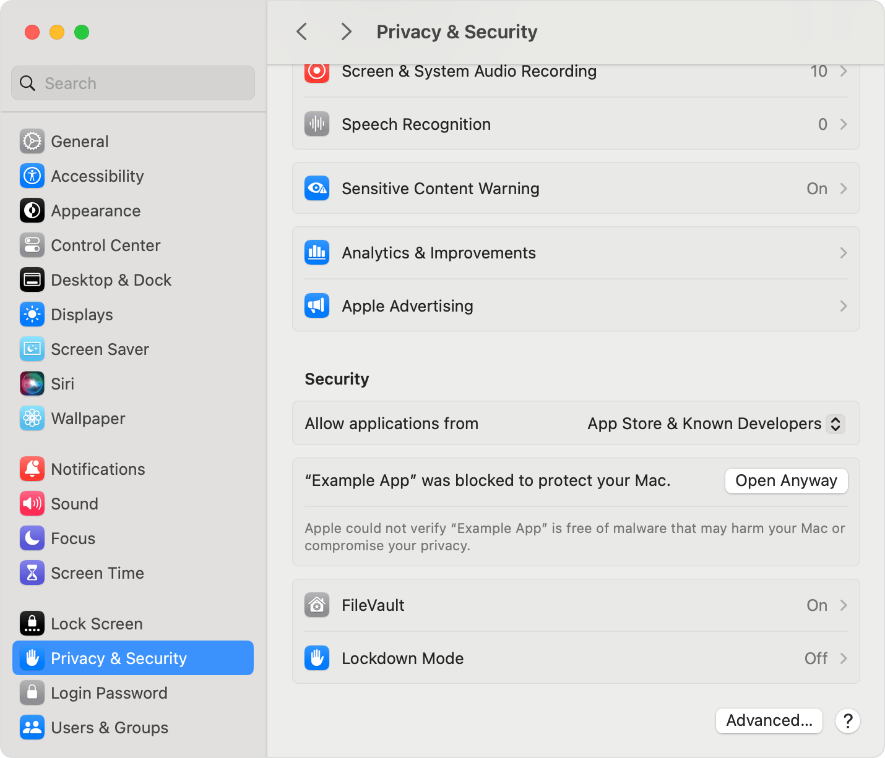
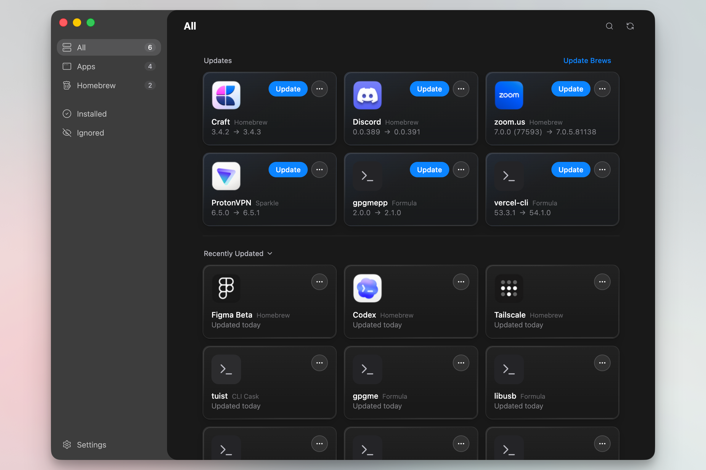
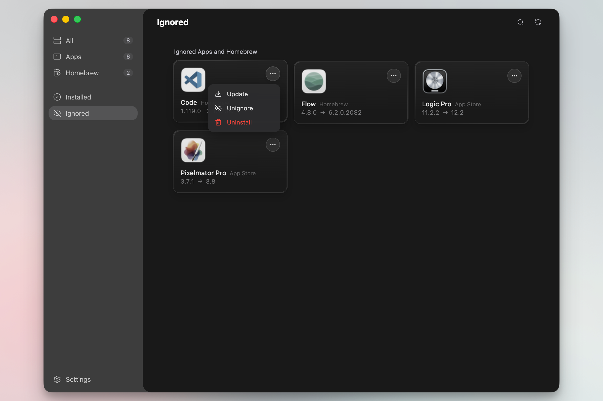
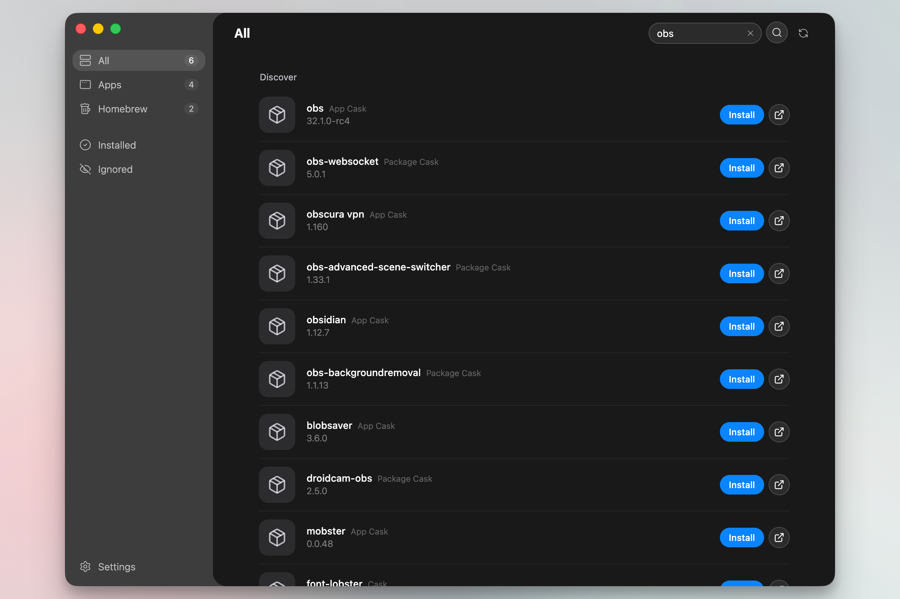
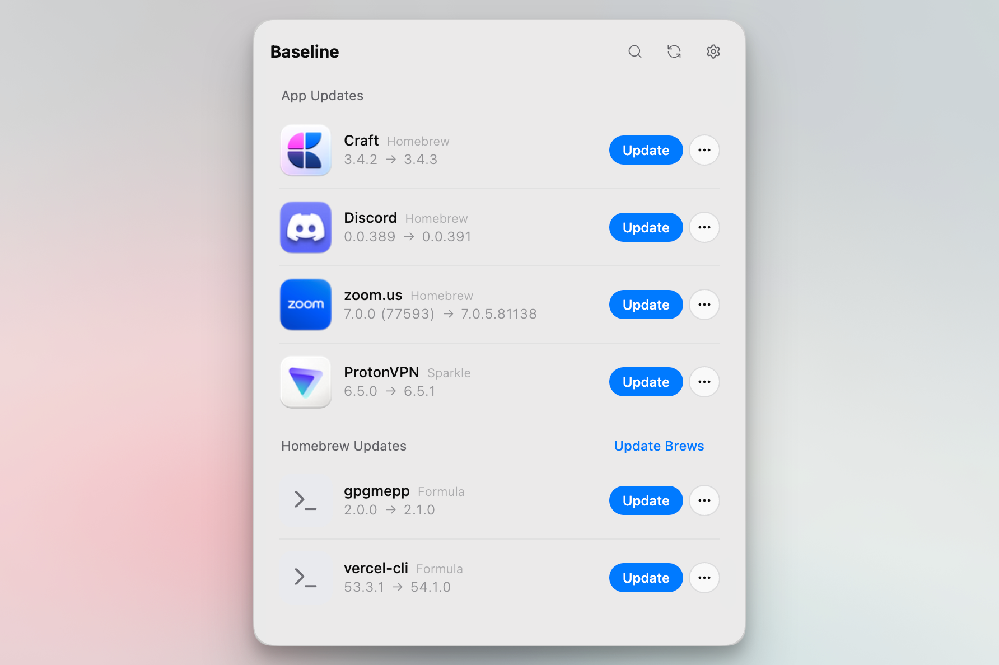

# Baseline

[](https://github.com/arshiaghaf/baseline/releases/latest)
&nbsp;
[](https://github.com/arshiaghaf/baseline/releases/latest)
&nbsp;
[](https://github.com/arshiaghaf/homebrew-tap)
&nbsp;
[](https://github.com/arshiaghaf/baseline/blob/main/LICENSE)

## Install

Requires Apple Silicon.

### Homebrew

```bash
brew install --cask arshiaghaf/tap/baseline
```

### First launch on macOS 15 and later

Baseline is ad-hoc signed, without Developer ID or notarization. macOS Gatekeeper may block the first launch after either a Homebrew or DMG install.

If you trust your official Baseline download:

1. Try opening Baseline from Applications. If macOS blocks it, dismiss the alert.
2. Open **System Settings > Privacy & Security**, scroll to **Security**, and click **Open Anyway** for Baseline.
3. Confirm the warning by clicking **Open**. Authenticate if macOS asks, then open Baseline again if needed.



Apple's macOS Sequoia (macOS 15) example above shows “Example App”; it is not a Baseline dialog. [Screenshot source](https://cdsassets.apple.com/live/7WUAS350/images/macos/sequoia/macos-sequoia-system-settings-privacy-and-security-open-app-anyway.png) and [Apple's guidance on safely opening apps](https://support.apple.com/en-us/102445).

Alternatively, after installing Baseline in `/Applications`, you can run this in Terminal **only for a trusted official download**:

```bash
xattr -dr com.apple.quarantine /Applications/Baseline.app
```

This removes quarantine from the app and its contents; it does not verify the app's safety. Try opening Baseline again afterward.

### GitHub Releases (DMG)

Download the DMG from [GitHub Releases](https://github.com/arshiaghaf/Baseline/releases), open it, and drag Baseline into Applications. Then follow the first-launch steps above.

## Baseline

Baseline is a macOS app for managing and updating installed Mac apps and Homebrew packages from one place.

It supports App Store apps, direct downloads, Sparkle-enabled apps, and Homebrew casks and formulae.

You can check for app updates, run Homebrew upgrades, search and install Homebrew packages, ignore specific items so they no longer appear as available updates, and open update pages for apps that require manual action.



## What Baseline Does

Baseline scans installed apps from system, user, and custom app directories, then checks public update sources for newer versions. It shows available updates, recently updated items, ignored items, and Homebrew discovery results without requiring a backend service or private APIs.

When the required local tooling is available, Baseline can run update and install actions through Homebrew or `mas`. When that tooling is unavailable, it provides external fallback links.

## Features

- Detects updates from App Store lookup, Sparkle and DevMate appcasts, and Homebrew metadata
- Provides unified update views for Mac apps, Homebrew casks, and Homebrew formulae
- Shows recently updated items so you can see what was updated and when
- Lets you ignore specific apps or Homebrew items so they stay out of the main update list
- Supports uninstalling Homebrew-managed casks and formulae from item actions
- Supports Homebrew search from the main window and menu bar tray to discover installable casks and formulae
- Lets you search installed apps and filter available updates
- Lets you hide the Dock icon in Settings > Appearance while keeping menu-bar access, with right-click actions for Refresh, Open Baseline, Settings, Check for Updates (Baseline itself), and Quit
- Provides external fallback links when local CLI tooling is unavailable







## Limitations

- Update detection is best-effort and depends on public update sources exposed by installed apps, Apple lookup endpoints, and Homebrew metadata.
- Homebrew actions require Homebrew to be installed. Without it, Baseline opens external Homebrew or app pages instead.
- App Store update actions use optional local `mas` support when available. Without `mas`, Baseline opens the App Store page externally.
- Packaged releases are ad-hoc signed, without Developer ID or notarization, so macOS Gatekeeper may warn when opening them. See [First launch on macOS 15 and later](#first-launch-on-macos-15-and-later).

## Privacy and Security

Baseline uses public update sources and local tooling. It does not require private Apple frameworks, a backend service, or an API key.

The app may query public services such as Apple lookup endpoints, Sparkle or appcast URLs declared by installed apps, and Homebrew metadata endpoints. Homebrew and `mas` actions run locally when you choose those update paths.

See [macOS permissions](docs/MACOS_PERMISSIONS.md) for conditional update approvals, administrator authorization, and recovery guidance.

Report suspected security issues using the process in [SECURITY.md](SECURITY.md).

## Contributing

Contributions are welcome. Start with [CONTRIBUTING.md](CONTRIBUTING.md), follow the pull request template, and run the validation commands before opening a PR.

Developer documentation:

- [Architecture](docs/ARCHITECTURE.md)
- [Continuous Integration](docs/CI.md)
- [Validation](docs/VALIDATION.md)

## License

Baseline is licensed under `GPL-3.0-only`. See [LICENSE](LICENSE) for the full
GNU General Public License v3.0 text.

Copyright (C) 2026 Arshia Ghaf.

Distributed modified versions must remain licensed under the GPL and include
the corresponding source code, license text, copyright notices, and other notices
required by the license.
